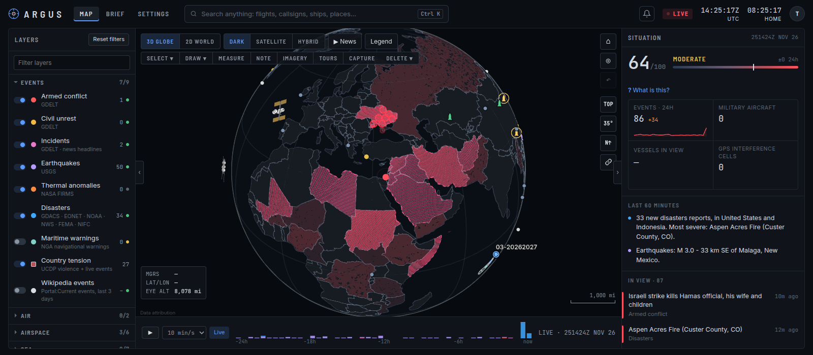
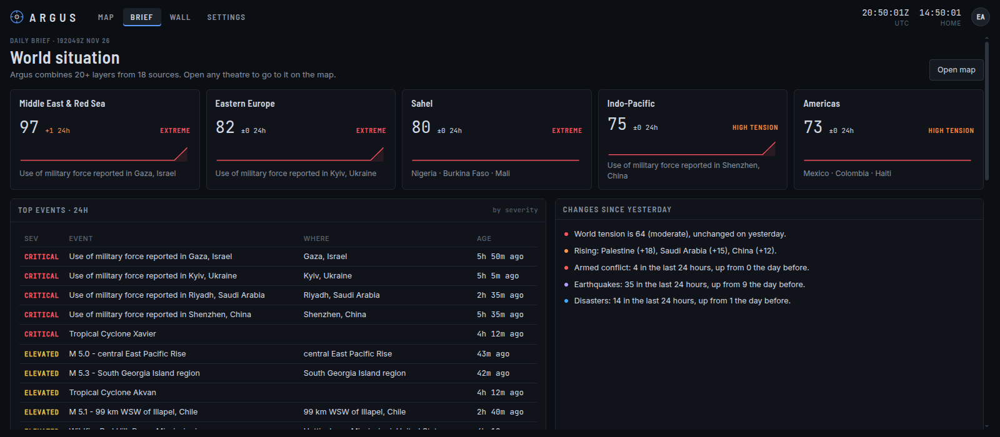
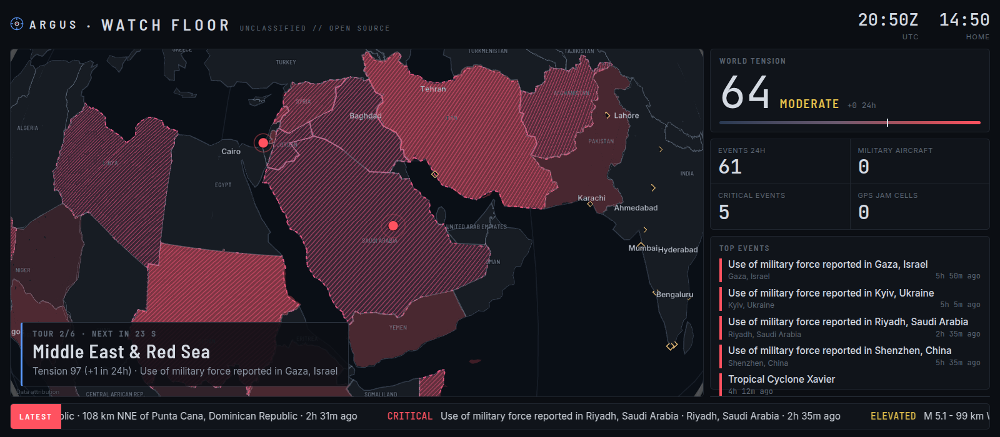
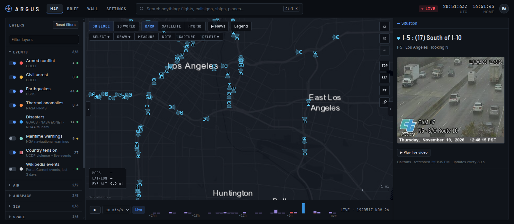

<p align="center">
  
</p>

<h1 align="center">Argus</h1>

<p align="center">
  The world, live, on your own server
</p>

<p align="center">
  <a href="https://github.com/twillislabs/argus/actions/workflows/ci.yml"></a>
</p>

<p align="center">
  
</p>

Argus is a self-hosted visualizer for open-source intelligence (OSINT). It brings conflict and
protest reports, earthquakes, fires, aircraft, ships, satellites, airspace, weather, cameras and
the news onto one 3D globe. Every marker shows where it came from and how sure Argus is about it,
and the whole thing runs from one `docker compose up` with no paid keys.

What it does today:

- **A 3D globe and 2D world map** (CesiumJS) that opens at your home location. The default dark
  map draws countries from bundled Natural Earth data. A **self-hosted street map**
  (OpenStreetMap, rendered on your server) takes over at street level inside
  the region you install. **Satellite** and **Hybrid** go down to street level, like Google
  Maps.
- **Live events**:
  - earthquakes from USGS every minute
  - conflict and protest reports from GDELT every 15 minutes
  - satellite fire detections from NASA FIRMS (with a free key)

  Events are merged across sources and pushed to the browser as they happen.
- **Aircraft.** Military aircraft worldwide every 15 seconds, with their role (tanker, ISR,
  airlift and so on), and civil traffic for whatever region you're looking at. Click one for its
  route and progress, then ride along in **Follow**, **Chase**, **Orbit** or **Cockpit**
  view (with a head-up display).
- **Ships.** Live AIS vessels (with a free AISStream key) by type, with flag, destination, speed
  and the same follow and chase views as aircraft. Ships on sanctions or shadow-fleet lists
  (OpenSanctions) are ringed in red.
- **Disasters and warnings.** GDACS and NASA EONET disasters, US tsunami warnings, and NGA
  navigational warnings (rocket launches, live firing, piracy) with their areas.
- **Airspace and interference.** FAA flight restrictions, SIGMETs, EASA conflict zone bulletins,
  restricted areas and control zones (with a free openAIP key), and GPS interference worked out
  from ADS-B accuracy.
- **Infrastructure.** Power plants by fuel (nuclear named), submarine cables, military bases and
  licence plate reader cameras mapped in OpenStreetMap (the DeFlock dataset).
- **World tension.** A per-country, theatre and world index anchored to UCDP conflict deaths, with
  live events on top, tinting the map.
- **Weather.** NWS warnings, watches and advisories (on their zone outlines), the SPC severe weather
  outlook, tropical storms, radar, lightning, satellite clouds and precipitation, animated wind,
  air quality, and conditions at home or anywhere you click.
- **Cameras and video.** Traffic cameras from Caltrans, TxDOT, WSDOT, DelDOT, TDOT (with a key),
  Austin, King County, Toronto, Calgary, DriveBC, London, Finland, Norway, Iceland and Hong Kong,
  with stills and live video, grouped by count when zoomed out; webcams from Windy and live YouTube streams near the view
  or about an event (with free keys).
- **AI assistants.** An MCP server so Claude and other assistants can read the map, with read-only
  API tokens.
- **Context.** US and UK travel advisories by country and Wikipedia's current events, placed on
  the map.
- **Air-raid alerts.** Ukraine by oblast and Israel by locality, live.
- **Space.** Rocket launches at their pads (Launch Library 2) and space weather from NOAA (storm
  scales, Kp, alerts).
- **Cyber.** Internet outages by country (IODA), ransomware claims per country and CISA's newly
  exploited vulnerabilities.
- **Patterns.** Military aircraft flying orbits or racetracks, and ships loitering on submarine
  cables.
- **Airports and ports.** Hover or click any of them for details and headlines; US airports show
  the FAA's live ground stops and delays.
- **Recent satellite imagery.** Draw a box for the newest Sentinel-2 (optical) or Sentinel-1
  (radar) pass over it, with a before-and-after split.
- **Alerts.** Your own rules (events near home or in a drawn area, air-raid alerts, ground stops,
  patterns, a watchlist, geomagnetic storms) delivered to the bell, your phone through ntfy, or
  a webhook (Discord, Slack, Home Assistant).
- **Optional AI.** Bring your own model (Anthropic, OpenAI or a local one such as Ollama) for a
  cited digest on the Brief, event summaries and **Ask Argus** questions over your data.
- **Live news.** A floating player with tabs for 18 channels that stream live around the clock,
  plus Ryan Hall, Y'all for major weather events.
- **Your own receivers.** readsb/tar1090 and AIS-catcher feeds merged into the map.
- **Satellites.** About 17,000 from CelesTrak, by orbit (LEO, MEO, GEO, HEO, Starlink), moved
  every second in your browser with SGP4. Click one for its orbit, ground track and its passes
  over your home.
- **Universal search.** Type a flight number (`AA100`), a hex or tail number, an airport, a
  place, coordinates, an event, a street address or a word like `tankers`, and Argus works out
  what you meant.
- **Corroboration before it hits the map.** Machine-coded GDELT reports start as *unconfirmed* and
  only become events when several independent outlets report them.
- **News from across the spectrum.** Headlines from 34 outlets (world and US desks), left
  and right, matched to the events they describe.
- **A situation panel** with counts by type, what's near home, a live feed, headlines and the
  health of every source. Click any event for its sources, coverage and raw record.
- **Brief and Wall.** A one-page brief for the start of a shift, and a hands-free watch-floor
  view that tours the theatres or shows live TV, for screens paired with a code, set up per
  screen or from shared profiles, with changes pushed to them at once.
- **Map tools.** Select an area and export what's in it, draw and measure, notes, a timeline you
  can replay, saved camera tours, share links and PNG capture.
- **First-run setup and accounts.**
  - A one-time setup token from the server log
  - Argon2id passwords and sessions with CSRF protection
  - Lockout and rate limiting, plus an audit log
  - More users with roles (admin, analyst, viewer, wall display) and temporary passwords
    they replace at first sign-in
- **Running it.** Backups and restore from Settings or the command line, `./argus update`,
  real visitor addresses behind a reverse proxy, and an optional self-signed certificate.
- **Built-in documentation** at `/docs/`, including how every part connects.

Still to come: NOTAMs, aircraft sanctions, ACLED and social media feeds.

<table>
  <tr>
    <td></td>
    <td></td>
  </tr>
  <tr>
    <td align="center"><sub>Brief: the start-of-shift overview</sub></td>
    <td align="center"><sub>Wall: the watch-floor tour</sub></td>
  </tr>
  <tr>
    <td></td>
    <td></td>
  </tr>
  <tr>
    <td align="center"><sub>Traffic cameras: stills and live video</sub></td>
    <td align="center"><sub>Aircraft: search, follow, route</sub></td>
  </tr>
</table>

## Quick start

You need Docker with the Compose plugin and `make`.

```sh
git clone https://github.com/twillislabs/argus.git
cd argus
make up        # writes .env with random secrets, builds and starts everything
make token     # prints the one-time setup token
```

1. Open **http://localhost:8080** and enter the setup token.
2. Create the admin account and pick your home location (any town of 15,000+ people, or
   coordinates).
3. Events start arriving within a minute. **Documentation** in the account menu (top right) has the rest.

Cookies are `Secure` by default, so plain HTTP needs `ARGUS_COOKIE_SECURE=false` in `.env`. That's
fine on localhost; anywhere else, put Argus behind a TLS reverse proxy such as Caddy. Fire
detections need a free [FIRMS map key](https://firms.modaps.eosdis.nasa.gov/api/map_key/) in
`ARGUS_FIRMS_MAP_KEY`.

## Run it

```sh
make up        # build and start (docker compose up -d --build)
make down      # stop it (data stays in the db-data volume)
make logs      # follow the API and the collector worker
make status    # containers and their health
make           # every target
```

| Service | What it does |
| --- | --- |
| `web` | nginx: serves the app and the docs, proxies `/api` and `/ws`, sets the security headers |
| `api` | FastAPI: accounts, sessions, events, live WebSocket; runs migrations on start |
| `worker` | Collectors (USGS, GDELT, RSS, FIRMS, adsb.fi / adsb.lol) and event fusion; publishes changes to NATS |
| `db` | PostgreSQL 17 with TimescaleDB and PostGIS |
| `nats` | NATS JetStream message bus between the worker and the API |
| `tiles` | tileserver-gl: renders the self-hosted street map (`make streetmap` installs a region) |

Only `web` is published to the host (port `ARGUS_HTTP_PORT`, default 8080).

## The guide

Argus serves its documentation at **`/docs/`**:
- **Getting started:** installing and first-run setup.
- **Administration:** the security model and every setting.
- **Technical:** a section on how it all connects, with diagrams of the request path, sign-in,
  backend, frontend, database, data pipeline and deployment.

Its source is Markdown in [`docs-site/docs/`](docs-site/docs/), built with Docusaurus
(`make docs-dev` for live reload).

## Develop

```sh
make install   # backend (uv), frontend and docs packages
make dev-api   # API with reload on :8000
make dev-web   # Vite on :5173, proxying /api and /ws
make test      # pytest
make lint      # ruff and the TypeScript check
make ci        # everything GitHub Actions runs, locally
```

| Path | What it holds |
| --- | --- |
| `backend/argus/` | The API: settings, models, auth, events, live updates, the place index |
| `backend/argus/collectors/` | One module per data source (USGS, GDELT, RSS, FIRMS) |
| `backend/argus/fusion.py` | Raw records into events: clustering, severity, promotion |
| `backend/argus/worker.py` | The collector scheduler and NATS publisher |
| `backend/argus/aviation.py` | Airports, airlines, the live aircraft picture and the ADS-B feed client |
| `backend/argus/search.py` | The universal search decoder |
| `backend/migrations/` | Alembic migrations, applied when the API starts |
| `frontend/src/` | The web app: React, TypeScript and CesiumJS (`pages/`, `components/`, `map/`, `lib/`, `styles/`) |
| `docs-site/` | The documentation (Docusaurus), served at `/docs/` |
| `scripts/ci.sh` | The CI checks, runnable locally |

API docs are at `/api/docs` while Argus is running.

Conventions: Python follows PEP 8 at 79 columns with ruff, and uses `str.format()` for strings.
TypeScript is strict. Commits follow Conventional Commits with 50/72 messages.

## Data and credits

- **Ports:** UN/LOCODE (UNECE), via the [datasets/un-locode](https://github.com/datasets/un-locode)
  mirror.
- **Ships:** [AISStream](https://aisstream.io/) (key). **Disasters:** [GDACS](https://www.gdacs.org/)
  (credit GDACS), [NASA EONET](https://eonet.gsfc.nasa.gov/), NOAA tsunami warning centres, and
  NGA Maritime Safety Information (public domain).
- **Airspace:** FAA TFRs, aviationweather.gov SIGMETs (NOAA), EASA conflict zone bulletins,
  [openAIP](https://www.openaip.net/) (key; CC BY-NC 4.0, cached, not stored).
- **Military bases:** © [OpenStreetMap](https://www.openstreetmap.org/copyright) contributors (ODbL).
- **Infrastructure:** [WRI Global Power Plant Database](https://datasets.wri.org/dataset/globalpowerplantdatabase)
  (CC BY 4.0); submarine cables from [TeleGeography](https://www.submarinecablemap.com/) (CC BY-NC-SA
  4.0, fetched onto your server, not bundled).
- **Live news:** each channel's own YouTube live stream, through YouTube's embed.
- **Satellites:** [CelesTrak](https://celestrak.org/) GP elements; SGP4 by
  [satellite.js](https://github.com/shashwatak/satellite-js) (MIT).
- **Street map:** © [OpenStreetMap](https://www.openstreetmap.org/copyright) contributors
  (ODbL), via the [Protomaps](https://protomaps.com/) daily build, rendered with
  [tileserver-gl](https://github.com/maptiler/tileserver-gl) (BSD); Noto Sans fonts (OFL).
- **Optional Google imagery:** with an admin's Google Maps Platform key, Satellite and Hybrid
  use Google's Map Tiles API, plus optional photorealistic 3D cities.
- **Maps and imagery:** Natural Earth (public domain), NASA GIBS (Blue Marble), and Esri (Dark
  Gray Canvas, World Imagery and reference layers; © Esri and its data providers).
- **Earthquakes:** USGS (public domain).
- **Weather:** NWS, SPC, NOAA nowCOAST, NASA GIBS, GDACS, [Open-Meteo](https://open-meteo.com/)
  (CC BY 4.0) for forecasts and air quality (Copernicus Atmosphere Monitoring Service data), and
  NOAA GFS wind via [PacIOOS](https://www.pacioos.hawaii.edu/) ERDDAP.
- **Events:** the GDELT Project.
- **Fires:** NASA FIRMS.
- **Conflict data:** [UCDP](https://ucdp.uu.se/) Georeferenced Event Dataset and Candidate
  Events (CC BY 4.0), Uppsala University, for the tension index's standing level.
- **Places:** [GeoNames](https://www.geonames.org/) (CC BY 4.0).
- **Aircraft:** [adsb.lol](https://adsb.lol/) (ODbL 1.0) and [adsb.fi](https://adsb.fi/) (open data, personal non-commercial use) for positions, [adsbdb](https://www.adsbdb.com/)
  for routes and types, [OurAirports](https://ourairports.com/data/) (public domain) and
  [OpenFlights](https://openflights.org/data) airlines (ODbL 1.0). Aircraft whose owners opted out
  (PIA, LADD) are hidden unless military, and owner names are never shown.
- **Traffic cameras:** each agency's public feed, credited by name on every camera: Caltrans,
  TxDOT, WSDOT, DelDOT, TDOT SmartWay, the City of Austin (public domain), King County (KCGIS
  terms of use), DriveBC, TfL (Powered by TfL Open Data), Fintraffic Digitraffic (CC BY 4.0), the
  Hong Kong Transport Department (DATA.GOV.HK), Statens vegvesen (NLOD), Vegagerðin (CC BY 4.0),
  and information licensed under the Open Government Licence – Toronto and the Open Government
  Licence – City of Calgary.
- **Radio:** [Radio Browser](https://www.radio-browser.info/) (public domain directory); streams
  play from each broadcaster.
- **Street photos:** [Panoramax](https://panoramax.fr/) contributors, each photo credited with its
  author and licence (mostly CC BY-SA 4.0).
- **Public transport:** each operator's GTFS-Realtime feed, credited on every vehicle: MBTA
  (MassDOT Developers' License Agreement), RTD, TTC and the City of Toronto, Calgary Transit and
  Edmonton Transit Service (Open Government Licences), BC Transit, HSL and Translink (CC BY 4.0),
  and OVapi. Images are fetched by your
  server only when someone opens a camera.
- **Globe:** [CesiumJS](https://cesium.com/platform/cesiumjs/) (Apache 2.0). Argus uses the
  open-source engine only, not the Cesium ion service.
- **Ideas:** [God's Eye View](https://github.com/bilawalsidhu/gods-eye-view) (MIT), for several
  planned features.
- **News headlines:** each outlet's own feed. Argus stores only the headline, a short excerpt and
  the link, and always links to the original.

## License

Argus is free and open source under the [Apache License 2.0](LICENSE):
you may use, modify and share it, including in commercial work, as long
as you keep the copyright and license notices and the [NOTICE](NOTICE)
file, credit the original project ("Based on Argus by twillislabs"), and
say what you changed. The data sources above keep their own licences;
some of them are for non-commercial use only.
