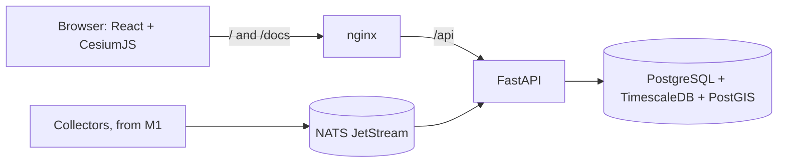

# Architecture

| Path | What |
|---|---|
| `backend/argus/` | FastAPI app: `api/` routers, `models.py`, `services.py`, `security.py` |
| `backend/migrations/` | Alembic migrations, applied on API start |
| `frontend/src/` | React app: `pages/`, `map/` (Cesium), `components/`, `lib/` |
| `docs-site/` | This documentation (Docusaurus 3) |
| `docs/PLAN.md` | Project plan and milestones |
| `docs/mockup/` | Interactive design mock |

## Frontend layout

| Path | What |
|---|---|
| `frontend/src/pages/` | One component per route |
| `frontend/src/components/` | Shared UI components |
| `frontend/src/map/` | Cesium globe and map layers (uses `@cesium/engine`, not the full `cesium` package, so no `eval` is needed under the CSP) |
| `frontend/src/lib/` | API client and helpers |
| `frontend/src/styles/` | `tokens.css` (colours, type), `base.css`, then one file per area |
| `frontend/public/img/` | Static images served as-is |

Built files land in `dist/` as `assets/js/` (app code plus `vendor-cesium`,
`vendor-react` and `vendor` chunks), `assets/css/`, `assets/fonts/`,
`assets/img/`, `img/` and `vendor/cesium/` (Cesium workers and assets).
