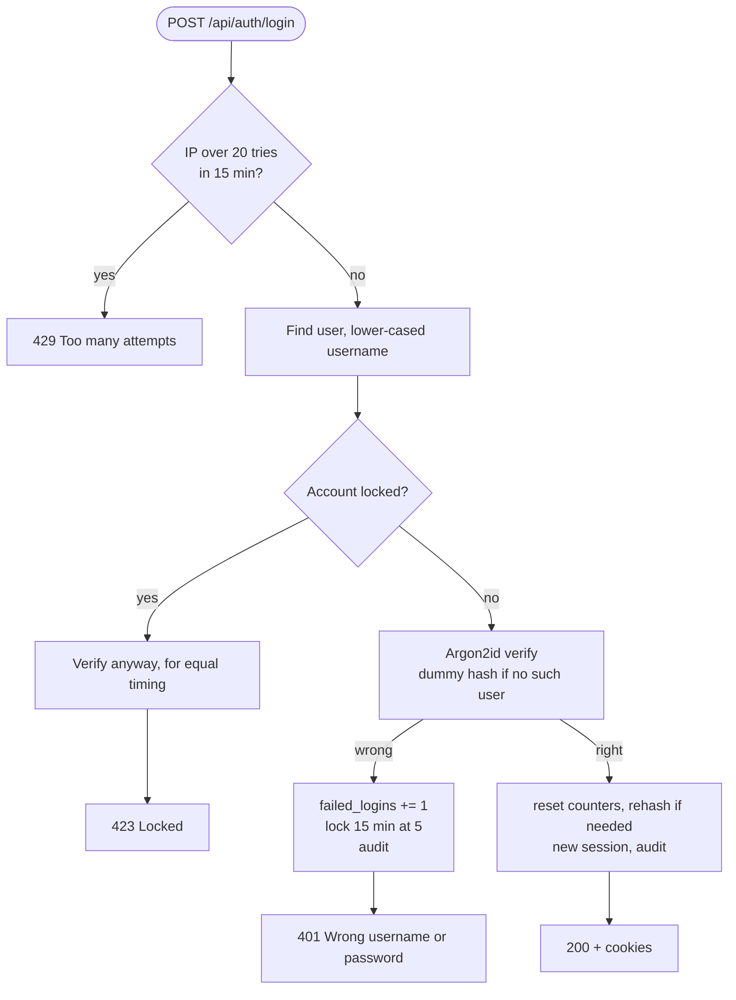

# Setup, sign-in and sessions

## First-run setup

```mermaid
sequenceDiagram
  autonumber
  participant L as API log
  participant A as API
  participant D as Database
  participant B as Browser
  A->>D: on start: count users
  alt no users
    A->>D: delete unused setup tokens
    A->>D: insert SHA-256(token), expires in 24 h
    A->>L: "Argus setup token: XXXX-XXXX-XXXX"
  end
  B->>A: GET /api/setup/status
  A-->>B: {needs_setup: true}
  Note over B: App routes to /setup (3 steps)
  B->>A: POST /api/setup {token, username, password, home}
  A->>D: users still 0? token hash matches an unused, unexpired row? (row locked)
  A->>A: password policy (12+ chars, not the username, not trivial)
  A->>D: insert admin user (Argon2id hash), preferences {home}, session; mark token used; audit
  A-->>B: 201 + Set-Cookie argus_session (HttpOnly) + argus_csrf
  B->>A: GET /api/me → map opens at home
```

- The token is compared after normalising it (upper case, letters and digits
  only), so `abcd efgh jkmn` and `ABCD-EFGH-JKMN` are the same.
- Only the SHA-256 of the token is stored. A database dump can't be used to
  finish setup.
- If two people race, the row lock on the token and the user-count check
  mean only one admin is created; the other gets `409 Setup is already
  complete`.

## Sign-in



## Sessions

| Item | How |
|---|---|
| Cookie token | 256-bit random (`secrets.token_urlsafe(32)`), `HttpOnly`, `Secure`, `SameSite=Lax` |
| Storage | `user_sessions.id` = SHA-256(token). The raw token is never stored |
| CSRF token | Random per session, sent in the readable `argus_csrf` cookie, which must be echoed in `X-CSRF-Token` on writes |
| Idle timeout | 12 h without requests (`last_seen_at`, refreshed at most once a minute) |
| Absolute lifetime | 7 days, or 30 days with "keep me signed in" (persistent cookie) |
| Sign-out | Deletes the session row and clears both cookies |

## Audit log

`audit_log` records `setup.completed`, `setup.token_rejected`, `auth.login`,
`auth.login_failed`, `auth.locked` and `auth.logout` with the time, user (if
known), client IP and a small JSON detail.
