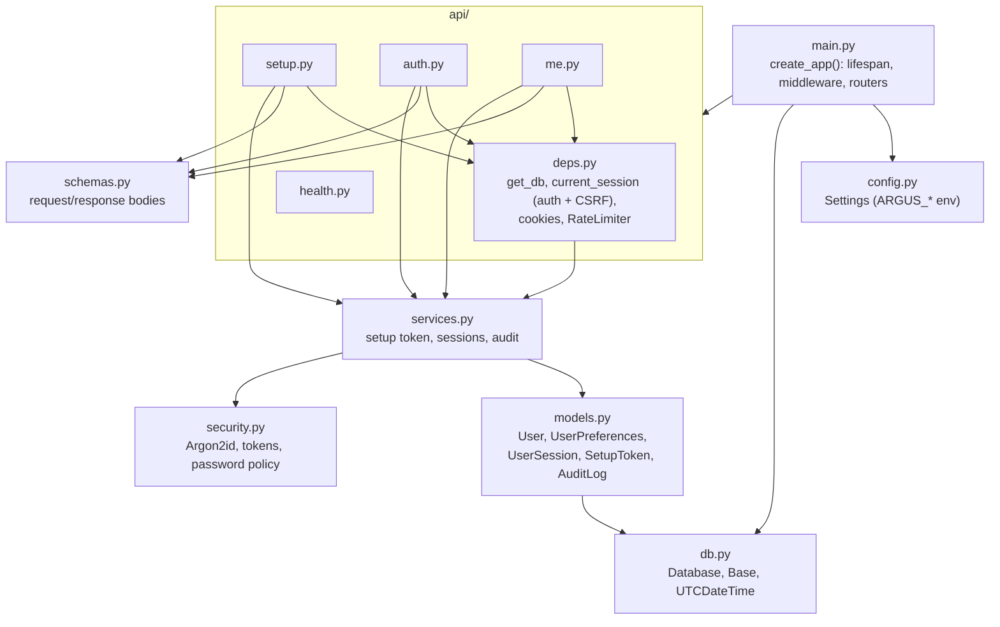

# Backend

FastAPI on Python 3.12, SQLAlchemy 2 (async) with asyncpg, Alembic,
pydantic-settings and argon2-cffi.

## Module map

| Module | Responsibility |
|---|---|
| `main.py` | Builds the app. On start it opens the database pool and issues a setup token if needed; on stop it closes the pool. It adds the security-header middleware and mounts routers. |
| `config.py` | Every setting with a safe default, read from `ARGUS_*` variables. |
| `db.py` | Engine and session factory. `UTCDateTime` keeps every timestamp timezone-aware in UTC on all databases. |
| `models.py` | ORM tables. |
| `schemas.py` | Pydantic models that validate every request body (unknown keys are rejected) and shape responses. |
| `security.py` | Password hashing and verification, token generation and hashing, and the password policy. |
| `services.py` | Database operations used by several routes: user count, setup token, session create/load, audit. |
| `api/deps.py` | FastAPI dependencies: DB session per request, current session with CSRF check, cookie helpers, the in-memory IP rate limiter. |
| `api/*.py` | One router per area. Handlers stay thin and call into services. |

## Endpoints (M0)

| Method | Path | Auth | Purpose |
|---|---|---|---|
| GET | `/api/health` | — | Liveness plus a database check |
| GET | `/api/setup/status` | — | `{needs_setup}` |
| POST | `/api/setup` | setup token | Create the first admin, sign in |
| POST | `/api/auth/login` | — | Sign in |
| POST | `/api/auth/logout` | session + CSRF | Sign out |
| GET | `/api/me` | session | User and preferences |
| PATCH | `/api/me/preferences` | session + CSRF | Merge preference keys (`home`, `basemap`, ...); `null` clears a key |

The full schema is at `/api/openapi.json`, and interactive docs are at
`/api/docs`.

## Migrations

Alembic lives in `backend/migrations/`. The API runs `alembic upgrade head`
before starting, so upgrades are just `docker compose up -d --build`. CI also
runs `alembic check` against PostgreSQL, which fails if the models and
migrations have drifted apart.

## Tests

`backend/tests/` uses pytest with SQLite (aiosqlite) and the real app,
lifespan included, through httpx's ASGI transport. They cover setup, token
handling, password policy, sign-in, lockout, rate limiting, CSRF, session
expiry, preferences and security headers.
