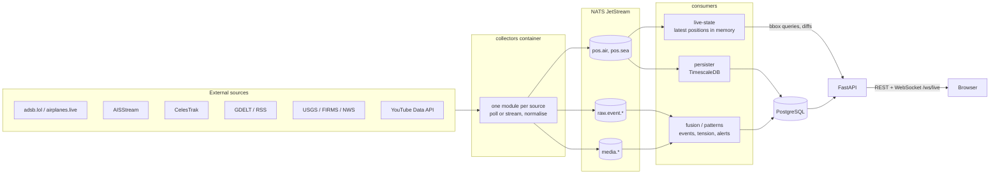

# Data pipeline

:::note Planned
This is the design for milestones 1–6. Today only the account and preference
paths exist. This page is kept up to date as each part lands.
:::

## Stages

1. **Collect.** Each source has a collector module that knows its API, rate
   limits and licence. It converts records to Argus schemas (`Position`,
   `RawEvent`, `MediaItem`) and publishes them to NATS subjects.
2. **Live state.** Consumes positions and keeps the latest state per entity
   in memory, answering "everything in this bounding box now" quickly. It
   publishes diffs to connected browsers over `/ws/live`.
3. **Persist.** Writes positions to a TimescaleDB hypertable (full rate for 7
   days, downsampled for 90) and raw records for 30 days. This is what replay
   reads.
4. **Fuse.** Clusters raw records into events (same type, within 25 km and
   2 h), scores severity (1–5) and confidence, attaches media and articles,
   detects patterns (orbits, tanker surges, AIS gaps, GPS interference) and
   updates the tension index.
5. **Alert.** Matches new and updated events against geofences, watchlists
   and rules, then notifies through the flash banner, wall mode, ntfy, email
   or webhooks.
6. **Serve.** The API answers map queries (bbox + layers + time), entity and
   event detail, search, and pushes live updates.

## Why a bus

AIS and ADS-B produce thousands of messages per second. NATS decouples
collectors from consumers: a slow database never blocks collection, a
collector can be restarted without losing consumers, and JetStream can
replay recent messages after a restart.
