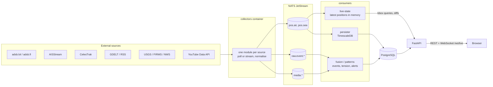

# Data pipeline

:::note Status
**Built (M1):** the worker with the USGS, GDELT, RSS and FIRMS collectors,
fusion v0, NATS publishing, and the API's `/ws/live` push. **Planned:** the
live-state and persister services for high-rate positions (aircraft, ships,
M2–M3), patterns and alerts.
:::

## What runs today

| Collector | Every | Becomes |
|---|---|---|
| `usgs` | 1 min | One event per quake (M2.5+, past day), updated when USGS revises it |
| `gdelt` | 5 min (files every 15 min) | Conflict and protest reports, clustered within 25 km and 2 h |
| `rss` | 10 min | Headlines in the `articles` table (34 outlets, 44 feeds by default: world and US desks, weighted towards conservative outlets) |
| `firms` | 3 h | Fire clusters (0.25 degree cells with 8+ detections); needs a key |
| `gdacs` | 15 min | GDACS disasters (floods, cyclones, volcanoes, droughts, wildfires), one `hazard` event each |
| `eonet` | 30 min | NASA EONET natural events (storms with their tracks, volcanoes...) as `hazard` events |
| `tsunami` | 5 min | Latest NTWC and PTWC bulletins; a warning is severity 5 |
| `faa_tfr` | 15 min | FAA TFR list joined to their shapes; `airspace` raw records |
| `sigmet` | 10 min | International and US SIGMETs from aviationweather.gov; `airspace` raw records |
| `czib` | 6 h | EASA conflict zone bulletins (parsed from EASA's table); `airspace` raw records |
| cables | 30 days | TeleGeography cables and landing points, kept in `server_settings["layer:cables"]` |
| ALPR cameras (API, per view) | 24 h cache | OpenStreetMap `surveillance:type=ALPR` from the Overpass API (overpass-api.de, then overpass.kumi.systems), in 1° tiles for the area being viewed, one request per server at a time in the background (two at once), kept a week in the `alpr_tiles` table, with the area around saved homes fetched ahead by the worker (`alpr_prefetch_loop`, every 6 h) and shared by every user (`argus/alpr.py`) |
| traffic cameras | 1 day | Caltrans CCTV (12 district JSON files), DriveBC webcams, TfL JamCams, Digitraffic weather cameras (one camera per preset) and, with a key, TDOT's open-data RoadwayCameras, kept in `server_settings["layer:trafficcams"]`; `/api/cams` serves the view, `/api/cams/{id}/image` proxies the still (cached 30 s); `/api/cams/{id}/video` returns the agency's HLS stream or MP4 clip URL, which the browser plays directly (hls.js, loaded on demand) |
| video and webcams (API, on request) | 30 min / 1 h / 8 min caches | YouTube Data API search (live near a point, or about an event) and Windy Webcams API (near the view), with admins' keys; shared caches in API memory (`argus/video.py`); Windy previews proxied, each linked to its Windy page |
| wikipedia | 1 h | Wikipedia's Current events portal, the last three days, through the MediaWiki API; each entry placed from its linked articles' coordinates; kept in `server_settings["layer:wikipedia"]` |
| launches | 2 h | Rocket launches (last three days, next two weeks) from The Space Devs' Launch Library 2, two requests a run; the last success is honoured across restarts (15 requests an hour per IP); kept in `server_settings["layer:launches"]` |
| cyber | 30 min | IODA country outages (last 24 h), ransomware.live latest claims counted per country (no victim names), and every 6 h CISA's Known Exploited Vulnerabilities; kept in `server_settings["layer:cyber"]`, each part keeping its last good answer |
| advisories | 6 h | US State Department travel advisories (cadataapi.state.gov) and UK FCDO travel advice (GOV.UK content API; only countries updated since the last pass are re-read), kept in `server_settings["layer:advisories"]` |
| receivers | 2 s / 10 s | Your readsb `aircraft.json` (NATS `argus.local_air`) and AIS-catcher `ships.json` (`argus.sea`) |
| `nga` | 1 h | NGA navigational warnings with positions, as `maritime` events |
| vessels (`aisstream`) | stream | AISStream WebSocket for the whole world (an admin's key); changes published on `argus.sea` every 5 s, kept in API memory (`LiveSea`), not stored |
| satellites (`celestrak`) | 6 h | The CelesTrak "active" catalogue (OMM elements, about 17,000), tagged from small groups (stations, weather, GNSS, military...). Stored in `satellites`; browsers propagate it with SGP4 |
| aircraft (`adsb_mil`) | 30 s | A snapshot of every military aircraft from adsb.fi (adsb.lol as a fallback), published on `argus.air`; not stored |

**Aircraft** take a lighter path than events. The worker polls the
military feed (adsb.fi, then adsb.lol) and publishes each snapshot on NATS. The API keeps the latest
positions and short trails in memory (`LiveAir`) and forwards the snapshot to
browsers over `/ws/live`. Civil traffic isn't collected at all: when the
browser's view is regional, the API asks adsb.lol (or adsb.fi when adsb.lol
is limiting) for that area (cached for 15 s, so many browsers looking at the
same place cost one request).
Privacy-flagged aircraft are dropped before anything is kept.

**Fusion rules (v0):**
- **Severity (1–5):** quakes by magnitude (M7+ is critical, M8+ catastrophic), bumped by a PAGER
  alert or tsunami flag. GDELT by event code, for example artillery or aerial attack is critical.
  Fires by detections and radiative power.
- **GDELT corroboration:** only lead-paragraph ("root") events count. A cluster is labelled by
  the kind of event most of its outlets reported, not the most alarming code any one used. It
  stays *unconfirmed* until:
  - 3 independent outlets report that same kind of event, with 10 articles in all (20 when the
    cluster has only GDELT's catch-all codes: military force, occupation, small arms), **and**
  - a headline from your news feeds backs it: it names the place (or country) and uses words
    for that kind of event (attack, shelling, missile... or protest, rally, strike...).

  GDELT pins national political coverage on seats of government (the White House, the
  Capitol, the Kremlin, Downing Street...), so events there need the place in the headline
  itself, from two different outlets. Events that lose their backing go back to unconfirmed.

  GDELT gives the same violence codes to crime, crash and court stories as to war. An
  unconfirmed cluster with only its catch-all codes (military force, assault, armed clash,
  small arms) is titled *Violence reported in …*; the specific label appears once it's
  confirmed. A cluster whose article links mostly read like police, court or crash stories,
  and rarely like fighting, is titled *Crime or police incident* and never confirmed.
  Unconfirmed reports are hidden unless you turn them on.
- **Expiry:** events expire after 24 h without updates (72 h for quakes) and are deleted after
  the retention period.
- **Coverage:** an event's articles are headlines naming its place or country within 18 h.

## Stages

1. **Collect.** Each source has a collector module that knows its API, rate
   limits and licence. It converts records to Argus schemas (`Position`,
   `RawEvent`, `MediaItem`) and publishes them to NATS subjects.
2. **Live state.** Consumes positions and keeps the latest state per entity
   in memory, answering "everything in this bounding box now" quickly. It
   publishes diffs to connected browsers over `/ws/live`.
3. **Persist.** Writes positions to a TimescaleDB hypertable (full rate for 7
   days, downsampled for 90) and raw records for 30 days. This is what replay
   reads.
4. **Fuse.** Clusters raw records into events (same type, within 25 km and
   2 h), scores severity (1–5) and confidence, attaches media and articles,
   detects patterns (orbits, tanker surges, AIS gaps, GPS interference) and
   updates the tension index.
5. **Alert.** Matches new and updated events against geofences, watchlists
   and rules, then notifies through the flash banner, wall mode, ntfy, email
   or webhooks.
6. **Serve.** The API answers map queries (bbox + layers + time), entity and
   event detail, search, and pushes live updates.

## Why a bus

AIS and ADS-B produce thousands of messages per second. NATS decouples
collectors from consumers: a slow database never blocks collection, a
collector can be restarted without losing consumers, and JetStream can
replay recent messages after a restart.
