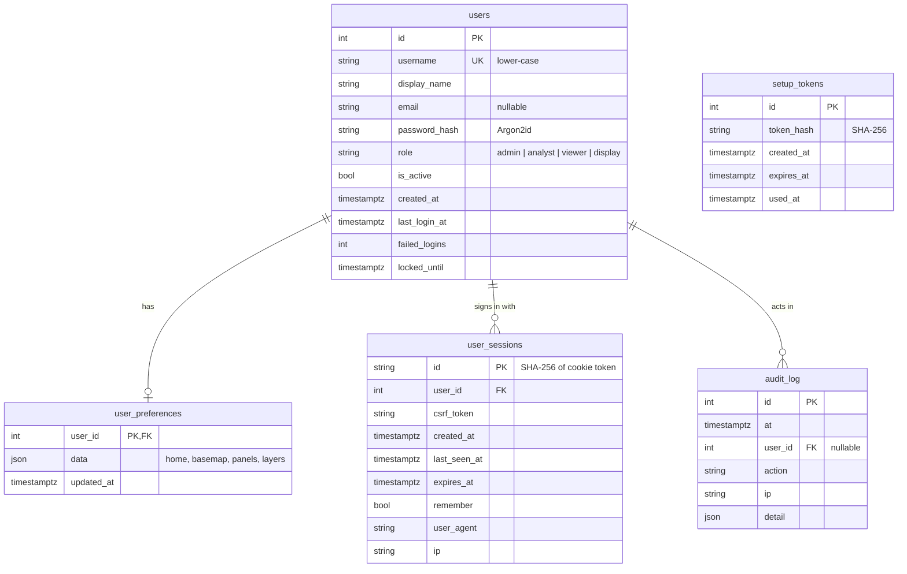

# Database

PostgreSQL 17 with TimescaleDB and PostGIS available (from the
`timescaledb-ha` image). Argus uses plain tables; the diagram shows the
accounts side, and the tables below cover the rest.

All timestamps are stored as `timestamptz` in UTC.

`tension_daily` (day, area, total, samples) holds the tension index's
hourly samples summed per day: `area` is a country name, `theatre:<id>`
or `world`. The baseline is `sum(total) / sum(world samples)` over the 90
days before today; rows older than that are pruned.

## Other tables

| Table | Holds |
|---|---|
| `sources` | Each collector's last run, last success, count and error (the Sources health table) |
| `raw_records` | Every record a source returned (trimmed), kept 30 days |
| `events`, `event_sources` | Fused events and the raw records behind them |
| `articles` | News headlines: headline, excerpt and link only |
| `server_settings` | Server-wide settings and layers kept by the worker (`keys`, `defaults`, `ai`, `layer:*` and so on); secrets in them are encrypted |
| `satellites` | The CelesTrak catalogue (orbital elements) |
| `tension_daily` | The tension index's daily totals (below) |
| `nws_zones` | NWS forecast zone outlines, for zone-based alerts |
| `alpr_tiles` | Plate reader cameras per 1° tile from OpenStreetMap, kept a week |
| `alert_rules`, `alert_channels`, `alerts` | Each user's alert rules, delivery settings (ntfy topic and webhook URL encrypted) and the alerts that fired, unique per rule and key |

Users' child rows (preferences, sessions, alert rules and channels,
alerts) are deleted with the user by `ON DELETE CASCADE`.
