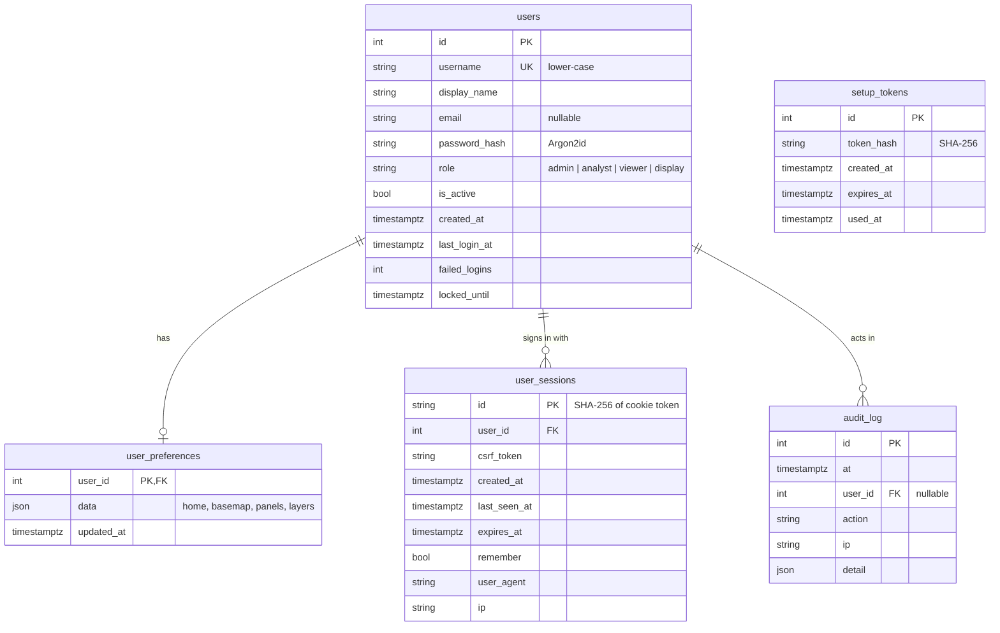

# Database

PostgreSQL 17 with TimescaleDB and PostGIS available (from the
`timescaledb-ha` image). M0 only uses plain tables; hypertables and spatial
columns arrive with the data layers.

All timestamps are stored as `timestamptz` in UTC.

`tension_daily` (day, area, total, samples) holds the tension index's
hourly samples summed per day: `area` is a country name, `theatre:<id>`
or `world`. The baseline is `sum(total) / sum(world samples)` over the 90
days before today; rows older than that are pruned.

## Planned tables

| Table | Milestone | Purpose |
|---|---|---|
| `entity` | M1–M3 | Aircraft, vessels, satellites, facilities |
| `position` (hypertable) | M2 | Time-stamped positions with PostGIS geometry |
| `raw_record` | M1 | Every record a source returned, kept for 30 days |
| `event`, `event_source` | M1 | Fused events and their source records |
| `media`, `article` | M5 | Event media and news coverage |
| `pattern` | M5 | Detected behaviour |
| `geofence`, `watch`, `alert_rule`, `alert` | M6 | Alerting |
