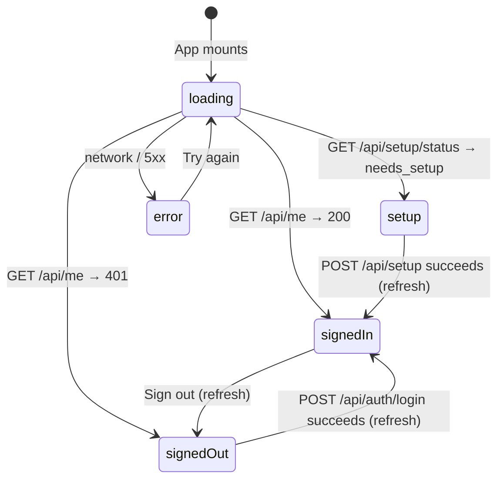

# Frontend

React 18 with TypeScript (strict), built by Vite. The globe is CesiumJS,
using the core `@cesium/engine` and `@cesium/core` packages.

## Boot sequence

`App.tsx` keeps this state and redirects: `/setup` while setup is needed,
`/login` when signed out, and `/` (the map) when signed in. Pages call
`onDone` / `onSignedOut`, which re-runs the boot check, so the server is
always the source of truth.

## Code layout

| Path | What |
|---|---|
| `src/main.tsx` | Entry: fonts, styles, router |
| `src/App.tsx` | Boot state machine and routes |
| `src/pages/` | `SetupPage`, `LoginPage`, `MapPage` |
| `src/components/` | `AuthShell`, `Brand`, `HomePicker` |
| `src/map/Globe.tsx` | Cesium widget, imagery, home marker, camera, 3D/2D |
| `src/lib/api.ts` | `fetch` wrapper: JSON, CSRF header, readable `ApiError` |
| `src/lib/cities.ts` | Offline city list and time-zone lookup for the home picker |
| `src/styles/` | `tokens.css` → `base.css` → `layout.css`, `controls.css`, `auth.css`, `map.css` |
| `public/img/` | Static images (favicon) |

## The globe

- `CesiumWidget` with no Cesium ion token: every tile comes from a source we
  configure. M0 uses NASA GIBS *Blue Marble Shaded Relief and Bathymetry*
  through WMTS.
- GIBS EPSG:4326 tiles are 512 px and span 288° at level 0, so the tiling
  scheme rectangle is `(-180, -198) – (396, 90)` with 2 × 1 root tiles.
  Using the default world rectangle puts the imagery in the wrong place.
- The home marker and the start view come from `preferences.home`. The ⌂
  button flies home, and the 3D Globe / 2D World buttons morph the scene.
- The full `cesium` package is used only for its static `Build/Cesium` files
  (workers, assets), copied to `/vendor/cesium/`. Its `Viewer` widgets bundle
  Knockout, which needs `eval` and would break the CSP.

## Build output

| Path in `dist/` | Contents |
|---|---|
| `index.html` | App shell |
| `assets/js/` | `index-*.js` (app), `vendor-cesium-*.js`, `vendor-react-*.js`, `vendor-*.js` |
| `assets/css/` | Stylesheets |
| `assets/fonts/` | Self-hosted Inter, JetBrains Mono, Barlow Semi Condensed |
| `img/` | Files from `public/img/` |
| `vendor/cesium/` | Cesium `Workers`, `Assets`, `ThirdParty`, `Widgets` |

Fonts are bundled, not loaded from Google Fonts, so the app makes no
third-party requests except for map tiles.
