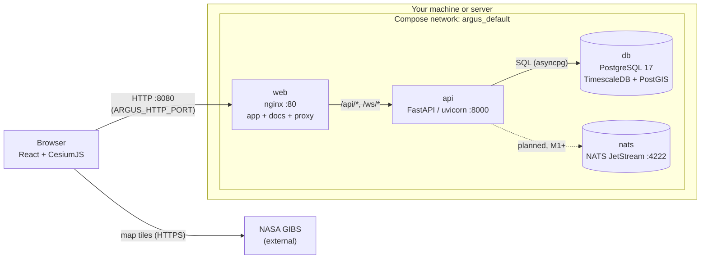

# System overview

Argus is four containers on one Docker network. Only `web` is published to
the host; everything else is reachable only from inside the network.

| Component | Built from | Talks to | Why it exists |
|---|---|---|---|
| **web** | `frontend/Dockerfile` | `api` | Serves the built React app at `/`, the docs at `/docs/`, and proxies `/api/` and `/ws/` to the API. It also sets the browser security headers (CSP and friends). |
| **api** | `backend/Dockerfile` | `db`, later `nats` | All business logic: setup, accounts, sessions, preferences, and later layers, events and live updates. It runs migrations on every start. |
| **db** | `timescale/timescaledb-ha:pg17` | — | The single source of truth. TimescaleDB holds time series (positions) and PostGIS holds spatial queries, both from M1. |
| **nats** | `nats:2.10-alpine` | — | The message bus between collectors and consumers. It is started now so the topology is stable, and used from M1. |

## What happens on `docker compose up`

1. `db` starts and becomes healthy (`pg_isready`).
2. `api` starts after `db` is healthy and runs `alembic upgrade head`, which
   applies any new migrations. Then uvicorn starts the app.
3. On start-up the app checks for users. If there are none, it creates a
   **setup token**, stores only its SHA-256 and prints the token to the log
   ([first-run flow](auth.md#first-run-setup)).
4. `api` reports healthy once `GET /api/health` answers 200.
5. `web` starts after `api` is healthy and serves on `ARGUS_HTTP_PORT`.

## Where things live in the repo

| Path | Runs in | Contents |
|---|---|---|
| `backend/argus/` | api | FastAPI app (see [Backend](backend.md)) |
| `backend/migrations/` | api (start-up) | Alembic migrations |
| `frontend/src/` | browser | React app (see [Frontend](frontend.md)) |
| `frontend/nginx.conf` | web | Routing, proxy and security headers |
| `docs-site/` | web (static) | This documentation |
| `docker-compose.yml` | host | Wiring of the four services |
