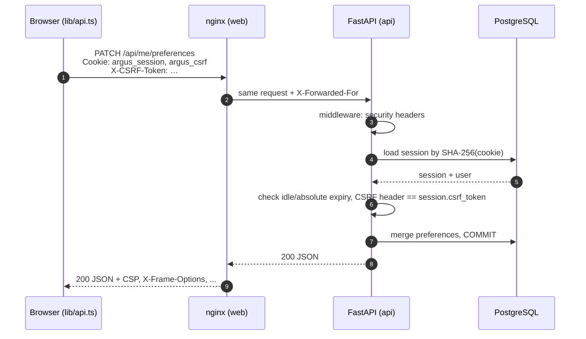

# Request path

## Routing in nginx

`frontend/nginx.conf` decides what serves each URL:

| Path | Served by | Caching |
|---|---|---|
| `/api/*` | proxied to `api:8000` with `X-Real-IP`, `X-Forwarded-For`, `X-Forwarded-Proto` | none (the API sends `Cache-Control: no-store`) |
| `/ws/*` | proxied to `api:8000` as a WebSocket upgrade | — |
| `/docs/*` | static Docusaurus build | default |
| `/assets/*` | hashed JS, CSS and fonts | 1 year (file names change on every build) |
| `/vendor/*` | Cesium workers and assets | 7 days |
| `/img/*` | static images | 7 days |
| everything else | `index.html` (the React router handles the path) | `no-cache` |
| `/healthz` | nginx itself | — |

## A typical API call

### Inside the API

Each request gets its own database session through the `get_db` dependency
(`backend/argus/api/deps.py`). Auth is a dependency too:

- `current_session` reads the `argus_session` cookie, looks up the session by
  its SHA-256, enforces expiry and, for anything other than GET/HEAD/OPTIONS,
  checks the `X-CSRF-Token` header against the session's CSRF token.
- Route handlers that need a signed-in user declare `session: SessionDep`,
  and that's all they need.

### Errors

Errors are JSON `{"detail": "..."}`. Messages are written for people ("Wrong
username or password."), and `lib/api.ts` turns them into `ApiError` with the
HTTP status, so pages can show them directly. Validation errors (422) carry
a list of field errors; the client shows the first one.

### Security headers

| Header | Set by | Value |
|---|---|---|
| `Content-Security-Policy` | nginx (pages), api (`/api/*`) | Pages: scripts only from the same origin (plus WebAssembly), tiles from NASA GIBS, no framing. API: `default-src 'none'`. |
| `X-Frame-Options` | both | `DENY` |
| `X-Content-Type-Options` | both | `nosniff` |
| `Referrer-Policy` | both | `same-origin` |
| `Cache-Control` | api | `no-store` on `/api/*` |
