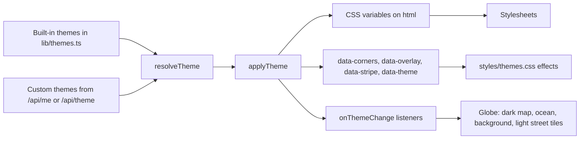

# Themes (technical)

How the theme engine works, and how to add a built-in theme. For using
themes and the custom theme format, see [Themes](../using/themes.md).

## How a theme is applied

- `frontend/src/lib/themes.ts` holds the built-in themes, the types, and:
  - `resolveTheme` fills in every value from the base theme.
  - `chooseTheme` picks yours, else the server default, else Argus
    Dark.
  - `applyTheme` sets the CSS variables and data attributes on
    `<html>`.
  - `applyServerTheme` does this for signed-out pages, from
    `/api/theme`.
- **CSS variables:** colours (`--bg`, `--surface`, `--accent`, and so
  on), map colours (`--map-*`), fonts (`--f-head`, `--f-body`,
  `--f-mono`), `--radius` and `--radius-s`, and `--glow` and
  `--glow-crit`. The stylesheets use these instead of fixed values;
  `styles/tokens.css` keeps Argus Dark's values as the fallback.
- **Data attributes:** `data-corners`, `data-overlay`, `data-stripe`
  and `data-theme` switch the rules in `styles/themes.css`: cut corners
  (`clip-path`), the screen overlay (`body::after`), the header stripe
  and the glow, plus a few theme-specific touches such as Hologram's
  frosted panels.
- **The globe:** `Globe.tsx` listens with `onThemeChange` and repaints
  the dark map (`darkMap.setPalette`), the ocean and the background, and
  switches the street tiles to Esri's light grey for a theme with
  `lightMap`. The sign-in globe (`AuthGlobe.tsx`) reads
  `currentTheme()` each frame.
- **Fonts:** they are self-hosted (`@fontsource`, imported in
  `main.tsx`), since the CSP doesn't allow font hosts. A browser
  downloads a font only when a theme uses it.

## Where themes are stored and checked

- **Your choice:** the `theme` preference (`schemas.Preferences`).
- **The server default:** `defaults.theme` (Settings › Defaults,
  `DefaultsIn`).
- **Custom themes:** `server_settings["themes"]` as `{"items": [...]}`,
  read and replaced by `GET` and `PUT /api/admin/themes` (capability
  `settings.manage`). They reach browsers in `/api/me` (`themes`).
- **Signed-out pages:** `GET /api/theme` (no session) returns the
  default's id, and its definition when it's a custom theme.
- **Checking:** `backend/argus/themes.py` (`clean`) checks every custom
  value against a fixed list or a strict pattern:
  - colours: hex, `rgb()` or `rgba()` only;
  - fonts, corners, overlays and stripes: known names;
  - radius and glow: numbers in range.

  The frontend applies values only through `style.setProperty` and data
  attributes, so a theme can't inject CSS.

## Adding a built-in theme

1. Add a `ThemeDef` to `BUILTIN_THEMES` in `lib/themes.ts`, with every
   colour and map colour, its fonts and its effects (see Argus Dark for
   the complete shape).
2. Add its id to `BUILTIN` in `backend/argus/themes.py`, so it can be a
   default and a custom theme's base.
3. For a new font: add the `@fontsource` package and its `import` in
   `main.tsx`, the id to `FONTS` in both `lib/themes.ts` and
   `argus/themes.py`.
4. For a new effect (an overlay or a stripe): add the name to the type
   and to `OVERLAYS` or `STRIPES` in both files, and its rules to
   `styles/themes.css` keyed by the data attribute.
5. Anything only your theme needs goes in `styles/themes.css` under
   `html[data-theme='your-id']`.
6. Update the table in [Themes](../using/themes.md).

Check a new theme on the map page, Settings, the Brief, the Wall and
the sign-in page, and at phone width.
